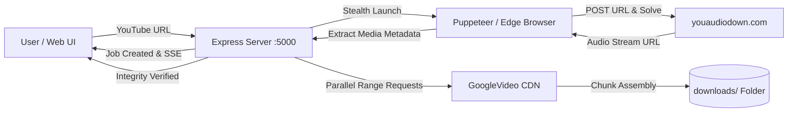

# 🎧 Music Download Agent

<div align="center">


**A powerful, standalone YouTube Music Download Agent built with React, Node.js/Express, and Puppeteer browser automation.**

[Features](#-key-features) • [Architecture](#-architecture) • [Getting Started](#-getting-started) • [API Docs](#-api-reference) • [Testing](#-running-tests)

</div>

---

## 🌟 Key Features

- **Automated Browser Conversion**: Navigates and controls [youaudiodown.com](https://youaudiodown.com/) using Microsoft Edge or Google Chrome with stealth configuration (`--disable-blink-features=AutomationControlled`, authentic browser User-Agents, and automated Turnstile challenge handling).
- **High-Speed Chunked Range Downloader**: YouTube limits raw audio streaming to playback bitrate (~35 KB/s). Our downloader partitions media requests into parallel HTTP byte-range chunks and merges them, allowing a typical 3.5 MB track to download in **under 3 seconds**.
- **Live Pipeline Streaming (SSE)**: Real-time progress updates via Server-Sent Events, updating the UI at every stage:
  1. `Validating URL`
  2. `Launching Browser`
  3. `Connecting & Submitting Form`
  4. `Processing & Converting Audio Stream`
  5. `Chunked Range Download`
  6. `Disk & Integrity Verification`
- **Modern Obsidian Dark UI**: Designed with glassmorphism, glowing pulse accents, responsive layout, live terminal logs, and a built-in HTML5 audio player.
- **Downloaded Library**: Embedded playback, file download, and delete controls directly managing the `downloads/` folder.
- **Fail-Safe Integrity**: Verifies file existence and non-zero byte size on disk before marking tasks complete.
- **Standalone**: Cleanly isolated from any other applications or games.

---

## 🏗️ Architecture



---

## 🔍 Inspected Website Interface

Before development, `https://youaudiodown.com/` was reverse-engineered to identify its exact selectors and client scripts:

| Element | Selector / Mechanism | Role |
|---|---|---|
| **Input Bar** | `#ymdUrlInput` (`.ymd-url-input`) | Target field where YouTube URL is typed |
| **Convert Button** | `#xrespond-tools-turnstile` (`.ymd-fetch-btn`) | Submits URL and triggers Turnstile verification |
| **Status Message** | `#ymdErrorMessage` | Displays conversion errors, blocks, or rate limits |
| **Preview Container** | `#ymdAudioPreview` | Becomes visible upon successful stream extraction |
| **Metadata** | `#ymdAudioTitle`, `#ymdAudioDuration`, `#ymdAudioUploader` | Track title, length, and artist |
| **Download Trigger** | `#ymdDownloadBtn` (`button[data-ymd-download]`) | Triggers direct stream resolution |

---

## 🚀 Getting Started (Windows)

### Prerequisites
- **Node.js**: v18.0.0 or later (v20+ or v24 recommended)
- **Browser**: Microsoft Edge (pre-installed on Windows 10/11) or Google Chrome
- **PowerShell Note**: If script execution is restricted on your machine, always use `npm.cmd` instead of `npm`.

### 1. Clone the Repository
```powershell
git clone https://github.com/aniljat1116-web/music-download-agent.git
cd music-download-agent
```

### 2. Install Dependencies

Install root server packages:
```powershell
npm.cmd install
```

Install React client packages:
```powershell
cd client
npm.cmd install
cd ..
```

### 3. Build Frontend
Compile the React frontend with Vite:
```powershell
npm.cmd run build
```

### 4. Run the Agent
```powershell
npm.cmd start
```

Open your browser and navigate to:
👉 **`http://localhost:5000`**

---

## 🛠️ Development Mode

To run backend and frontend with hot-reload enabled:

```powershell
# Terminal 1 - Backend (port 5000)
npm.cmd run server

# Terminal 2 - Frontend Vite Dev Server (port 3000)
npm.cmd run client
```

Navigate to `http://localhost:3000`. API calls are automatically proxied to port 5000.

---

## 🧪 Running Tests

The test suite validates URL parsing, Windows-safe filename sanitization, Chromium/Edge executable resolution, Express endpoints, and executes a real end-to-end browser automation download into `downloads/`:

```powershell
npm.cmd test
```

### Expected Output:
```text
==================================================
🧪 RUNNING MUSIC DOWNLOAD AGENT TEST SUITE
==================================================
✅ POST /api/validate [Valid URL] passed
✅ POST /api/validate [Invalid URL] passed
✅ GET /api/downloads passed
✅ GET / (Static React Frontend) passed
✅ [PASS] Standard watch URL
✅ [PASS] Short youtu.be URL
✅ [PASS] YouTube Shorts URL
✅ [PASS] Raw 11-char Video ID
✅ [PASS] Reject invalid URLs
✅ [PASS] Sanitize Windows illegal filename characters
✅ [PASS] Format file size correctly
✅ [PASS] Detect Chromium/Edge browser on Windows
✅ [PASS] Automate youaudiodown.com and download Rick Astley audio

Verified File: Rick Astley - Never Gonna Give You Up (Official Video) (4K Remaster).m4a
File Size: 3.29 MB (3449447 bytes)
Elapsed Time: 15s

==================================================
🏁 TEST RESULTS: 9/9 PASSED
==================================================
```

---

## 📡 API Reference

### `POST /api/validate`
Validates whether a URL or ID is a valid YouTube video.
```json
{ "url": "https://www.youtube.com/watch?v=dQw4w9WgXcQ" }
```

### `POST /api/download`
Starts a download job asynchronously and returns a `jobId`.
```json
// Response
{ "jobId": "job_1729661234_a1b2c3", "status": "started" }
```

### `GET /api/progress/:jobId`
Server-Sent Events (SSE) stream providing real-time percentage, phase, and logs.

### `GET /api/downloads`
Returns the list of all files downloaded to the `downloads/` directory.

### `GET /api/downloads/:filename`
Streams or downloads the audio file. Supports HTTP `Range` headers for seeking in audio players.

### `DELETE /api/downloads/:filename`
Permanently deletes a file from the server's `downloads/` folder.

---

## 📄 License
This project is licensed under the [MIT License](LICENSE).
